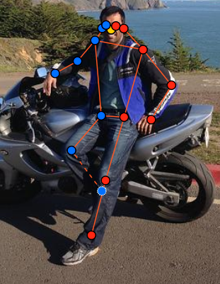
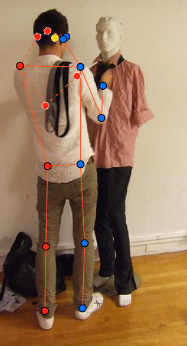
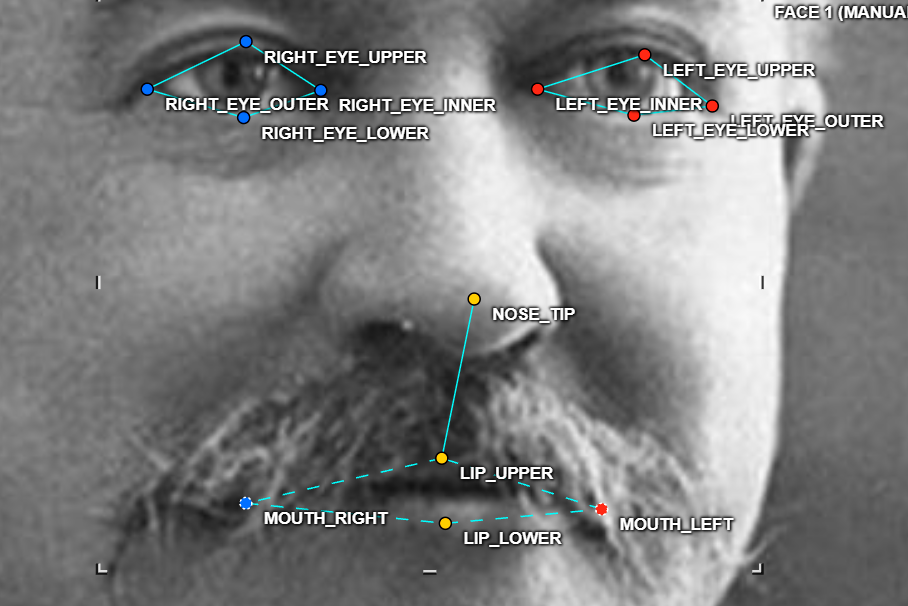
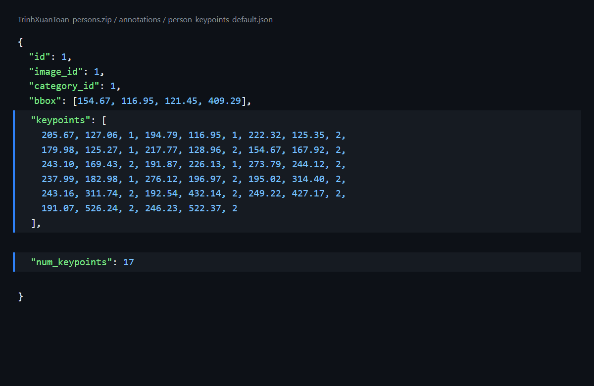

# Báo cáo cá nhân — Trịnh Xuân Toàn — 2A202603121

Dữ liệu: 12 ảnh người và 8 ảnh khuôn mặt crop từ COCO 2017 (Lin et al., 2014), chỉ dùng trong lớp.

## 0. Thông tin học viên

- Họ tên: Trịnh Xuân Toàn
- MSSV: 2A202603121
- Email: trinhtoant2005@gmail.com
- Link repository: **BẮT BUỘC TỰ ĐIỀN sau khi tạo repo cá nhân**
- Phiên bản CVAT (Help → About): 2.74.1
- Máy: Windows 10 · RAM 8 GB · chạy CVAT chế độ đầy đủ
- Bộ ảnh (`src/exports/assignment.json` do `lab.py setup` tạo): có
- Giờ bắt đầu: **BẮT BUỘC ghi đúng thời gian thực tế**
- Giờ kết thúc: **BẮT BUỘC ghi đúng thời gian thực tế**

> **Cần xác nhận trước khi nộp:** `assignment.json` hiện ghi MSSV `02603121`, không
> khớp `2A202603121`. Không sửa file này bằng tay; hỏi LC MSSV nào phải dùng để
> chia bộ ảnh.

## 1. Kiểm tra label (CP0)

| Label | Kiểu | Số điểm | Tên điểm đúng bảng của lab? | Đúng thứ tự? | Số cạnh |
|---|---|---:|---|---|---:|
| `person` | Skeleton | 17 | Có | Có | 19 |
| `face` | Skeleton | 13 | Có | Có | 13 |

Mẫu `person` dựng theo người quay mặt về camera (các điểm `left_*` nằm bên phải khung mẫu)? Có

Cách đổi cờ `occluded` / `outside` cho **một điểm** trên phiên bản CVAT này (một câu):

Rê chuột vào đúng điểm cần đổi rồi nhấn `Q` để bật/tắt `occluded`, hoặc nhấn
`O` để bật/tắt `outside`; chỉ điểm đang được trỏ chuột thay đổi.

## 2. Số lượng đã gán và thời gian (CP1, CP2)

| Nhóm ảnh | Số ảnh | Số skeleton đã gán | Số người dưới 60 px (không gán) | Số poster / gương / màn hình bỏ qua | Thời gian (phút) |
|---|---:|---:|---:|---:|---:|
| `easy` | 5 | 5 | **tự điền** | **tự điền** | **tự điền** |
| `occluded` | 3 | 4 | **tự điền** | **tự điền** | **tự điền** |
| `back` | 2 | 5 | **tự điền** | **tự điền** | **tự điền** |
| `small` | 1 | 2 | **tự điền** | **tự điền** | **tự điền** |
| `crowd` | 1 | 3 | **tự điền** | **tự điền** | **tự điền** |
| `faces` | 8 | 0 trong bản xuất hiện tại | — | **tự điền** | **tự điền** |

- Số ảnh người đã xong ở mốc phút 105: **BẮT BUỘC TỰ ĐIỀN** / 10
- Thời gian thực tế (phút): CP1 **tự điền** · CP2 **tự điền** · CP3 **tự điền**
- Ảnh tốn thời gian nhất là ảnh nào, vì sao?

**BẮT BUỘC TỰ ĐIỀN theo quá trình làm thật.**

## 3. Bảng ca khó (CP1, CP2)

Mỗi điểm bạn phân vân một dòng, nhất là phân vân giữa `v = 1` và `v = 0`, hoặc không chắc hướng người.

> Mục này phải do học viên tự điền từ quá trình gán thật; quy định bài không cho AI viết hộ.

| Ảnh | Người / mặt | Điểm | Cờ đã chọn | Phân vân giữa | Lý do chọn |
|---|---|---|---:|---|---|
| | | | | | |
| | | | | | |
| | | | | | |

## 4. Bảng tự review (CP3)

Đi từ ảnh cuối về ảnh đầu. 5 ảnh người (ít nhất 2 ảnh `back` hoặc `crowd`) và 3 ảnh mặt. Ít nhất 8 dòng, kể cả dòng `ok`. Ghi lỗi trước, sửa sau.

Mã lỗi dùng đúng một trong: `lr_swap`, `vis_flag`, `position`, `missing`, `extra`, `ok`.

> Mục này phải do học viên tự review và tự điền; quy định bài không cho AI viết hộ.

| Ảnh | Người / mặt | Điểm | Mã lỗi | Ghi chú | Đã sửa? |
|---|---|---|---|---|---|
| | | | | | |
| | | | | | |
| | | | | | |
| | | | | | |
| | | | | | |
| | | | | | |
| | | | | | |
| | | | | | |

Tổng hợp số lỗi theo mã:

| `lr_swap` | `vis_flag` | `position` | `missing` | `extra` | `ok` |
|---:|---:|---:|---:|---:|---:|
| | | | | | |

Điểm còn phân vân giữa `v = 1` và `v = 0` (ghi cả hai lựa chọn và lý do chọn):

...

## 5. Kiểm file xuất và kết quả tự kiểm (CP4)

Tự kiểm tay trong file JSON:

| File | Người / mặt kiểm (ảnh, thứ tự) | Số phần tử `keypoints` | Điểm `outside` ra `v = 0`, `occluded` ra `v = 1`? | `num_keypoints` khớp? |
|---|---|---:|---|---|
| `TrinhXuanToan_persons.zip` | `000000123544.jpg`, người 1 | 51 | Có: 1 điểm `v=0`, 3 điểm `v=1` | Có: 16 |
| `TrinhXuanToan_persons.zip` | `000000324953.jpg`, người 1 | 51 | Có: 6 điểm `v=0`, 2 điểm `v=1` | Có: 11 |
| `TrinhXuanToan_faces.zip` | **Chưa kiểm được: bản xuất có 0 skeleton** | — | — | — |

Sau khi xuất, CVAT ghi `occluded` thành `v = 1` và `outside` thành `v = 0`.
Tọa độ của điểm `outside` trong file persons là tọa độ cũ.

Hai job đã chuyển sang completed trên CVAT? **Không** — persons đang `in progress`, faces đang `new`.

Dán phần **TÓM TẮT** in ra từ `src/check_submission.py`:

```text
- File person: TrinhXuanToan_persons.zip
  Số ảnh: 12 · số skeleton `person`: 19 · mỗi annotation 51 số
  Skeleton theo ảnh: 000000090646=1, 000000123544=3, 000000175703=1,
  000000183176=1, 000000210604=2, 000000240340=1, 000000253584=2,
  000000308257=1, 000000309169=3, 000000324953=2, 000000349521=1,
  000000399983=1
  Cờ v: v=2 245 (76%) · v=1 66 (20%) · v=0 12 (4%)
  num_keypoints trung bình: 16.4
- File face: TrinhXuanToan_faces.zip
  Số ảnh: 8 · số skeleton `face`: 0 · mỗi annotation 39 số
- Số [LỖI]: 1 · số [CẢNH BÁO]: 10
Kết quả: CHƯA ĐẠT (1 lỗi). Sửa trên CVAT rồi xuất lại.
```

> Phần tóm tắt trên chỉ phản ánh bản xuất hiện tại. Sau khi gán đủ 8 khuôn mặt,
> chạy lại `python lab.py export` và thay toàn bộ khối này bằng kết quả `ĐẠT` mới.

Các `[CẢNH BÁO]` còn giữ nguyên và lý do:

- `000000308257.jpg` người 1: cảnh báo cặp ankle; cần tự xem lại tư thế trước khi quyết định giữ hoặc sửa.
- `000000309169.jpg` người 3: cảnh báo cặp knee/ankle; cần tự xem lại tư thế trước khi quyết định giữ hoặc sửa.

## 6. Ảnh chụp màn hình

1. Label `person` trong label constructor (đủ 17 điểm có tên):

   

2. Một người quay lưng đã gán, cờ đã đặt:

   

3. Một khuôn mặt đã gán 13 điểm, phóng to vùng mắt:

   

4. Một đoạn JSON xuất của một người:

   

Nguồn ảnh: COCO 2017.

## 7. Tự đánh giá

> Mục này phải do học viên tự viết; quy định bài không cho AI viết hộ.

1. Lỗi bạn mắc nhiều nhất hôm nay, và cách bạn sẽ tránh ở dự án thật:

   ...

2. Một quy tắc bạn đề xuất thêm vào guideline (kèm ảnh ví dụ nếu có):

   ...

3. Nhãn của bạn đi vào model ở đâu? Chọn một lỗi bạn đã sửa và nói nó sẽ làm model học sai thế nào (heatmap, trọng số trong loss, hay bước lật ảnh):

   ...

## 8. Khó khăn và lỗi kỹ thuật

- Job faces chính chưa có skeleton trong CVAT; bản xuất hiện tại chưa đạt.
- Bonus persons còn 5 điểm ngoài ảnh nhưng đang để `v=2`; cần sửa trên CVAT nếu nộp bonus.
- `assignment.json` ghi MSSV khác tên báo cáo; cần xác nhận với LC, không sửa JSON bằng tay.

## Bonus (nếu làm)

### B1 — 3 ảnh người khó thêm

| Ảnh | Số skeleton | Số người dưới 60 px | Ca khó nhất |
|---|---:|---:|---|
| `000000125998.jpg` | 2 | **tự điền** | **tự điền** |
| `000000465765.jpg` | 3 | **tự điền** | **tự điền** |
| `000000507223.jpg` | 3 | **tự điền** | **tự điền** |

Kết quả `src/check_submission.py` cho `HoVaTen_bonus_persons.zip`:

```text
Kết quả hiện tại: CHƯA ĐẠT (5 lỗi).
000000125998.jpg có 5 điểm wrist/hip nằm ngoài ảnh nhưng đang để v=2.
```

### B2 — 5 ảnh khuôn mặt đen trắng / hồng ngoại

Ảnh không màu khó hơn ở điểm nào? Kính râm trên ảnh hồng ngoại có còn là `v = 1` không?

**BẮT BUỘC TỰ ĐIỀN nếu nộp B2.** Bản xuất hiện tại chỉ có 1/5 skeleton khuôn mặt.

### B3 — Model so với nhãn của tôi (không tính điểm)

- Không thực hiện B3.

## 9. Tài liệu tham khảo và công cụ AI đã dùng

- Tài liệu của bài: `README.md`, `RULES.md`, `CHECKPOINTS.md`, `SUBMISSION.md`,
  `docs/GUIDELINE.md`, `docs/COCO_KEYPOINTS.md` và `docs/CVAT_CHEATSHEET.md`.
- Codex được dùng để đọc yêu cầu nộp bài, kiểm tra cấu trúc ZIP/JSON, chạy
  `check_submission.py`, giải thích lỗi và hỗ trợ định dạng các phần thông tin khách
  quan của báo cáo. Codex không tạo keypoint và không viết hộ Bảng ca khó, Bảng tự
  review hoặc Tự đánh giá.
